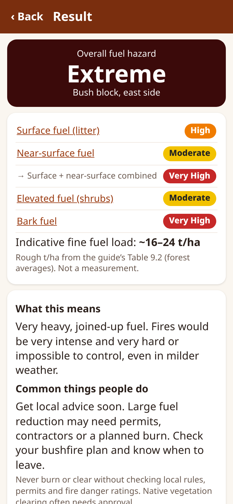
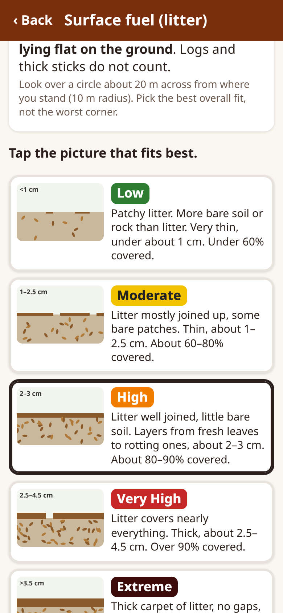

# Fuel Check

A **free** phone app for a simple, repeatable look at **bushfire fuel hazard** on a block of land: rate the four fuel layers, get an **overall fuel hazard** (Low → Extreme) with a colour, a plain-English meaning and common actions, plus photos, GPS and exports.

For landholders, shire / council officers, volunteer fire brigades and schools — anywhere in the world, but grounded in the recognised Australian **Overall Fuel Hazard Assessment Guide**. Plain language, works on cheap Android phones, **works offline after the first load**, no account, no server, no adverts.

**Open the app:** https://johnrichardszpe-dot.github.io/fuel-check/
(Then use your browser menu → *Add to Home screen* / *Install app*.)

By **John Richards**. Version 0.1.0.

 

> **Not an official assessment.** Fuel Check is not a BAL (AS 3959) assessment, a bushfire management plan, or a firebreak / asset protection zone inspection, and it is not legal advice. Local rules differ — check with your local fire authority or council (in Western Australia: [DFES](https://www.dfes.wa.gov.au/) and your shire's firebreak notice).

## How to use (plain English)
1. **New place** — type a name (e.g. *Back paddock*), pick the main vegetation, stand in the middle and tap **Get GPS**. Save.
2. **Start a fuel check** — four short steps, one per fuel layer: **surface** (litter on the ground), **near-surface** (low grass, sedges, low shrubs touching the ground), **elevated** (shrubs and young trees) and **bark**. Look around you (about 10 m radius; 20 m for bark), read the short descriptions and tap the drawing that fits best. Optionally type litter depth (mm) and % cover for a hint, and take a photo of each layer (compass bearing is saved).
3. **Result** — the overall fuel hazard with colour, what it means, common actions, an indicative fuel load (t/ha), and links to fire authority advice. Add notes and **Save check**.
4. **Come back** to the same spot each year (same season, e.g. before the fire season) and do another check. The place shows all checks over time.
5. **Share summary** (text for SMS / email / WhatsApp), **Export CSV** (spreadsheet), or **Backup file** (JSON, photos optional) and **Restore** on another phone. Data lives only on your phone — back it up.

## Method
Each layer is rated **Low (L), Moderate (M), High (H), Very High (VH) or Extreme (E)** using shortened descriptions of the guide's key attributes (Tables 3.1, 3.3, 3.5, 4.1, 5.1, 6.1). Bark type limits the possible bark ratings, as in the guide: fine fibrous / stringybark M–E (use this if ≥10 % of trees are fibrous), ribbon / candle bark M–VH, other bark L–H, no trees = L.

The ratings are combined exactly as in the guide (verified cell by cell against the 4th-edition PDF; see `logic.js` and `test.js`):

**Table 7.1 – combined surface + near-surface** (rows = surface, columns = near-surface)

| Surface ↓ / NS → | L | M | H | VH | E |
|---|---|---|---|---|---|
| **L** | L | L | M | H | VH |
| **M** | M | M | H | VH | E |
| **H** | H | VH | VH | VH | E |
| **VH** | VH | VH | E | E | E |
| **E** | E | E | E | E | E |

**Table 8.1 – Overall Fuel Hazard** (rows = bark group × elevated, columns = combined surface/near-surface)

| Bark | Elevated | L | M | H | VH | E |
|---|---|---|---|---|---|---|
| Low or Moderate | L | L | M | M | H | H |
| | M | L | M | M | H | H |
| | H | L | M | H | VH | VH |
| | VH | VH | VH | VH | VH | VH |
| | E | E | E | E | E | E |
| High | L | L | M | H | H | H |
| | M | L | M | H | H | H |
| | H | L | H | H | VH | VH |
| | VH | VH | VH | VH | VH | E |
| | E | E | E | E | E | E |
| Very High or Extreme | L | L | VH | VH | VH | E |
| | M | M | VH | VH | E | E |
| | H | M | VH | E | E | E |
| | VH | E | E | E | E | E |
| | E | E | E | E | E | E |

Check: the guide's own cover example (bark E, elevated M, near-surface L, surface VH) gives Overall **Extreme** — reproduced by the tests.

**Optional hints.** Litter depth and % cover give a *suggested* rating from Tables 4.1 / 5.1 / 6.1 (e.g. litter <10 mm L, 10–25 M, 20–30 H, 25–45 VH, >35 mm E). The guide's ranges overlap and it asks for a "best fit of all key attributes", so the app splits overlaps at their midpoint and only shows a hint — **you choose the rating**.

**Indicative fuel load.** The t/ha range is the sum of the guide's Table 9.2 indicative loads for each layer's rating (forest averages from Project Vesta / Victorian studies). It is not a measurement. WA visual fuel load guides (below) are a better local check for scrub fuels.

**What this means / common actions** are generic, written for this app, and point to local fire authority advice. Drawings are simple SVG sketches made for this app, not the guide's photographs.

## Sources
- Hines F, Tolhurst KG, Wilson AAG, McCarthy GJ (2010) *Overall Fuel Hazard Assessment Guide*, 4th edition, July 2010. Fire and Adaptive Management Report no. 82, Victorian Government Department of Sustainability and Environment, Melbourne. ISBN 978-1-74242-677-8 (online). Tables 3.1–8.1, 9.2 used. [PDF (DSE/FFM Vic)](https://www.ffm.vic.gov.au/__data/assets/pdf_file/0005/21110/Report-82-overall-fuel-assess-guide-4th-ed.pdf)
- FESA / DFES Western Australia, *Visual Fuel Load Guide* series — e.g. *Visual Fuel Load Guide for the Scrub Vegetation of the Swan Coastal Plain, including the Geraldton Sandplains and Leeuwin Ridge*; *Visual Fuel Load Guide for Esperance Plains Bioregion and part of the Jarrah Forest Bioregion* (2010). Photo guides of scrub fuel in t/ha bands (5–10, 10–15, 15–25, 25+), sampled with 1 m² quadrats of fine fuel <10 mm (dry g/m² ÷ 100 = t/ha), with leaf litter added separately. [DFES publications](https://publications.dfes.wa.gov.au/)
- Standards Australia, **AS 3959** *Construction of buildings in bushfire-prone areas* — Bushfire Attack Levels BAL-LOW, 12.5, 19, 29, 40, FZ from vegetation class, slope, distance and fire danger index (Method 1) or detailed calculation (Method 2). **Context only; Fuel Check does not calculate BAL.** A BAL must be done by an accredited assessor / per your state's rules.
- WA Planning Commission, *Guidelines for Planning in Bushfire Prone Areas* (SPP 3.7), and shire firebreak notices — e.g. an Asset Protection Zone (around 20 m from habitable buildings) kept below **2 t/ha** fine fuel. Check your own shire's current notice.

## Known limits
- Not an official assessment, BAL, bushfire management plan or legal advice. Local rules, seasons and enforcement differ.
- The guide was developed for **eucalypt forests and woodlands** of south-eastern Australia. It suits grassland, crops, heath, mallee, plantations, gardens and overseas vegetation less well; ratings there are a rough guide.
- Ratings are observer judgement; layer descriptions are shortened summaries — read the full guide for training.
- Ignores weather, Fire Danger Rating, grass curing, fuel moisture, slope, canopy fuel and coarse fuel (logs).
- Phone GPS is often 5–15 m out; phone compasses 10° or more.
- Data is stored only on the phone (IndexedDB); clearing the browser deletes it. Export / back up.

## Features (v0.1)
- Places with name, vegetation type, notes and GPS (best fix kept, accuracy shown), map link (OpenStreetMap).
- Guided 4-step check with layer diagram, five drawn example pictures per layer, bark-type rules, optional litter depth and % cover hints, photo per layer with compass bearing (rear camera, JPEG ≤1280 px, or file picker).
- Automatic combined and overall rating (Tables 7.1 & 8.1), colour, meaning, common actions, indicative t/ha, fire-authority links (all Australian states + WA shire note).
- Repeat checks over time; CSV export, JSON backup/restore (photos optional), shareable text summary.
- Offline PWA with versioned service worker; all text in `strings.js` for translation.

## For developers
Plain HTML/CSS/JS, no build step. `node test.js` checks all 25 + 75 table cells, every one of the 625 layer combinations for monotonicity, hints, loads and CSV. `browser-test.js` (puppeteer-core + Chrome) runs a full check, photo, result and an offline reload: `PUPPETEER=/path/to/puppeteer-core node browser-test.js http://localhost:8000/ shot.png`. When you change any file, bump `CACHE` in `sw.js`.

Licence: not yet chosen (all rights reserved until a licence is added).
